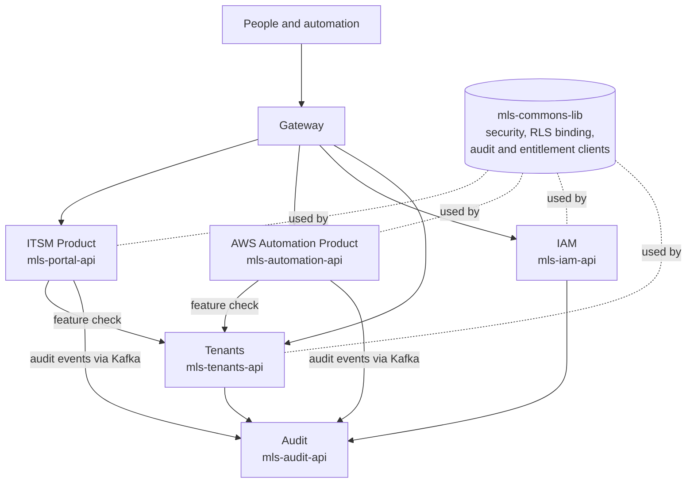

# Multi-Tenant Platform and Products

Decision: [ADR-0013](/Decisions/ADR-0013-Multi-Tenant-Platform-With-Products). Source pattern: PLATFORM-SPEC-v3 sections 1, 3, 4, 5, 7 and 12.

**Status: design. Nothing here is built yet except the repositories, branch policies and the first slice of the AWS Automation environment status API (draft).**

## The idea in one picture

## What each piece owns

| Service (repository) | Owns |
|---|---|
| Gateway (`mls-gateway-api`) | Edge routing, CORS, a real edge token pre-check, per-tenant rate limiting, and answering `/internal/**` with 404 for anything from outside |
| Tenants (`mls-tenants-api`) | The tenant registry and tree, resolution from host, tenant code or domain (exact match only), lifecycle, provisioning bitmask, **and entitlements: packages, Products, feature groups, features, overrides and the live-feature answer** |
| IAM (`mls-iam-api`) | Users, groups, roles and scopes per tenant and Product, sign-in configuration, the trusted-issuer map for per-issuer token validation |
| Audit (`mls-audit-api`) | Entity-change audit and security-event audit, append-only, partitioned by month, automatic retention |
| ITSM Product (`mls-portal-api`) | Tickets, workflow, approvals, SLA, reports, evidence |
| AWS Automation Product (`mls-automation-api`) | Environments, provisioning, status reports, versions, deployments, state machines |

## Packages, Products and features

A tenant has one **package**. A package contains **one or more Products** (ITSM, AWS Automation). Each Product has **feature groups**, and each group has **features**. The platform's own Administration and Audit features are mandatory and belong to no package. Full model, rules and catalogue: [Packages and Feature Flags](/Packages-and-Feature-Flags). This follows Baton's model with the Product layer added.

## The tenancy and entitlement model (tables)

The table list below is the first sketch; the entitlement tables are specified in the [Entitlement Model](/Packages-and-Feature-Flags/Entitlement-Model) (`products`, `feature_groups`, `features`, `packages`, `package_products`, `package_groups`, `package_features`, `package_limits`, `tenant_overrides`, `tenant_limit_overrides`, `tenant_features`), which supersede the `product`, `package`, `feature`, `package_feature` and `tenant_feature_override` rows here.

| Table | Owner | Purpose |
|---|---|---|
| `tenant` | Tenants | `tenant_id`, `slug`, `name`, `domain`, `status` (provisioning, active, suspended, offboarded), `tenant_type`, `parent_tenant_id`, `parent_access_level`, `realm_name`, `provisioning_steps_completed` (bitmask) |
| `product` | Entitlements | `code` (`itsm`, `automation`), `name`, `status` |
| `package` | Entitlements | A named tier **of one Product**: `product_id`, `name`, `type`, `billing_cycle` |
| `feature` | Entitlements | A capability **of one Product**: `product_id`, stable `code`, display `name` |
| `package_feature` | Entitlements | `package_id`, `feature_id`, `is_enabled`, `access_level` |
| `tenant_product` | Tenants / Entitlements | The Product a tenant has selected and its package: `tenant_id`, `product_id`, `package_id`, `status`, `since` |
| `tenant_feature_override` | Entitlements | `tenant_id`, `feature_id`, `is_enabled`, `access_level`, `reason`, `set_by`, `set_at` |
| `scope` | IAM | A permission of one Product, tied to the feature it needs: `product_id`, `key`, `feature_code` |
| `role` | IAM | `tenant_id` (null for a built-in template), `product_id`, `name`; roles belong to one Product |
| `role_scope`, `user_role`, `group_member`, `group_role` | IAM | As in the access model, now inside a tenant |
| `user_account` | IAM | `tenant_id`, `email` (unique within the tenant), `status` |
| `auth_provider_config` | IAM | Trusted issuers: issuer, JWKS address, audience, status, `tenant_id` |

Every tenant-owned table in every service carries `tenant_id`, with row-level security **forced** and a default-deny policy keyed on the tenant bound to the connection.

## How a request is decided

1. The Gateway forwards the request; the service validates the token against the issuer the tenant is mapped to (per-issuer validation, size limit applied before the token is read).
2. A second step looks the caller up in IAM's data by email, checks the tenant and the person are active, and computes their scopes for **that Product**.
3. For each scope the endpoint needs, the Entitlements answer for `(tenant, feature)` is read: override, else package of the selected Product, else global default, **deny**. A scope without an entitled feature is dropped.
4. The database binds the tenant (and person) to the connection; row-level security does the rest.
5. Every change and every refusal is written through the shared audit client. A refusal returns one fixed shape whatever check failed.

## Open points

- Tenant hierarchy (MSSP style, one hop) is part of the spec's registry; the lab starts with one tenant. Whether the hierarchy and the parent access level are built now is undecided.
- Where the platform services run for the lab (EKS in Env-2 beside the Products, or on the shared services hosts) is open.
- How a Product is switched on for a tenant (a ticket-driven change or an administrator screen) is open.
- The ITSM Product keeps the repository name `mls-portal-api`; renaming to `mls-itsm-api` is possible and not decided.
