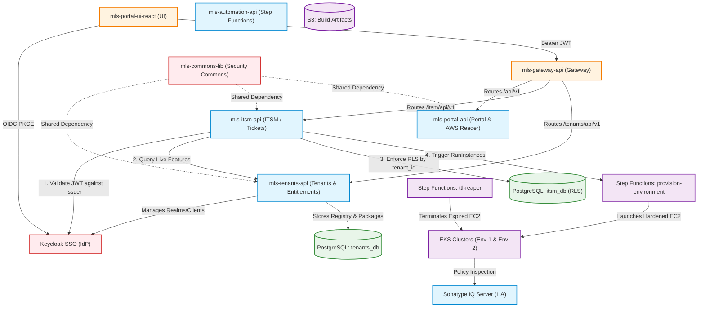
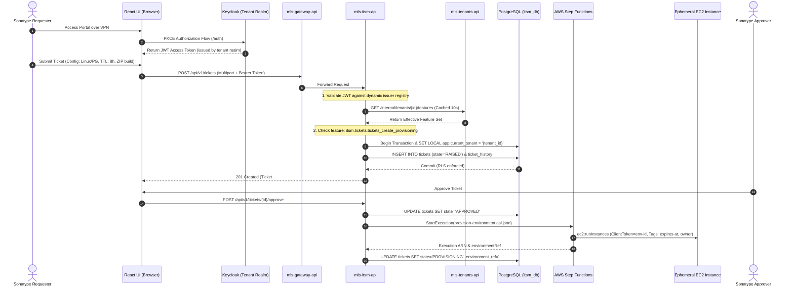
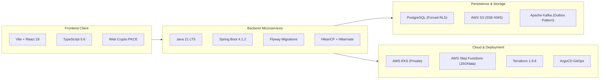
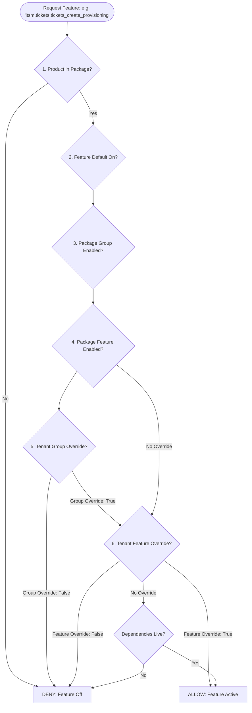
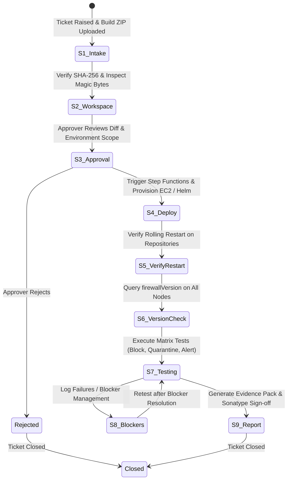
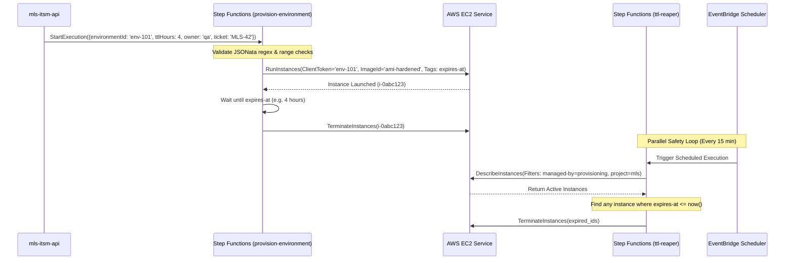

# Sonatype Managed Lab (MLS) — Complete Technical Knowledge Base & Graphify Architecture Guide

---

## 1. Executive Summary & Business Purpose (SOW #8)

### What is the Sonatype Managed Lab?
The **Sonatype Managed Lab (Project code: `mls`)** is a dedicated, highly secure, multi-tenant AWS cloud platform built by Motivity Labs under **Statement of Work (SOW) #8**. Its mission is to provide an isolated, enterprise-grade environment where **Sonatype Repository Firewall** (powered by **Sonatype IQ Server**) can be continuously integrated, tested, and validated against diverse artifact repositories, CI/CD platforms, and ephemeral infrastructure configurations.

### What Business Problem Does It Solve?
Enterprises integrate Sonatype Repository Firewall across fragmented environments—different repository engines (Artifactory, Harbor, Cloudsmith), diverse package formats (Maven, npm, PyPI, Docker), and various CI/CD runners (GitLab, Azure DevOps, AWS CodePipeline). Validating that Firewall accurately enforces policies (**Audit**, **Quarantine**, **Namespace Confusion Protection [NCP]**, and **Policy-Compliant Component Selection [PCCS]**) without breaking developer workflows requires:
1. **On-Demand Ephemeral Test Environments:** Disposable Linux and PostgreSQL configurations spun up on demand with mandatory Time-To-Live (TTL) expiration.
2. **Safe, Immutable Plugin Deployments:** Deploying and rolling back the Sonatype Firewall plugin across multi-node Artifactory/Harbor clusters safely without configuration drift.
3. **Audited Self-Service Portal (ITSM):** A controlled service desk where Sonatype stakeholders can request environments, upload build artifacts, review approvals, track SLAs, and inspect tamper-evident audit evidence.
4. **Strict Multi-Tenancy:** A platform capable of serving multiple customer organizations (tenants) with complete data isolation, fine-grained feature flags, and custom package entitlements.

### Project Timeline & Delivery Constraints
* **Build Timeline:** 6 weeks (October 26, 2026 – December 4, 2026), followed by 12 months of managed services to October 25, 2027.
* **Working Hours:** 11:00 AM – 7:00 PM IST, Monday through Friday.
* **Primary Region:** Mumbai (`ap-south-1`) across 3 Availability Zones.
* **Disaster Recovery (DR) Region:** Hyderabad (`ap-south-2`) operating in pilot-light mode.
* **Network Boundary:** **Zero public ingress.** Access is strictly via dual-tunnel Site-to-Site IPsec VPN using BGP routing.

---

## 2. Graphify: The Interconnected Knowledge Graph

To provide queryable insights across repositories, code, infrastructure, database schemas, and workflows, the system is modeled as an interconnected **Knowledge Graph**.



### Knowledge Graph Node & Edge Taxonomy

| Node Type | Node Instances | Key Attributes |
|---|---|---|
| **Repositories** | `mls-portal-ui-react`, `mls-itsm-api`, `mls-tenants-api`, `mls-commons-lib`, `mls-portal-api`, `mls-automation-api`, `mls-infra`, `ado-platform`, `mls-fwplugin-bundle`, `mls-audit-api`, `mls-gateway-api`, `mls-iam-api` | `area`, `kind`, `publishes`, `branch_policy` |
| **Services / Products** | `platform` (mandatory), `itsm` (tickets/approvals), `automation` (environments/reaper) | `key`, `name`, `status`, `mandatory` |
| **Security Controls** | `RlsConnectionProvider`, `DynamicIssuerResolver`, `RequiresFeature`, `FeatureGuardInterceptor` | `isolation_mode`, `cache_ttl`, `deny_default` |
| **Databases & Tables** | `tenants`, `tenant_features`, `packages`, `tickets`, `ticket_history`, `platform_audit` | `rls_enabled`, `append_only`, `uuid_version` |
| **Infrastructure Units**| `network-vpc`, `eks-cluster`, `step-functions`, `rds-postgres`, `transit-gateway` | `region`, `multi_az`, `encryption_kms` |

### Querying the Knowledge Graph (Technical Decision Guide)
* *Query: "How does an API call guarantee tenant data isolation?"*
  * **Path:** `JWT Token` $\to$ `PlatformAuthentication` $\to$ `TenantContextFilter` $\to$ `TenantContext.set(tenantId)` $\to$ `RlsConnectionProvider` $\to$ PostgreSQL `set_config('app.current_tenant', tenantId, false)` $\to$ PostgreSQL `FORCE ROW LEVEL SECURITY` policy $\to$ Query executed.
* *Query: "What happens if a tenant requests a feature outside their tier?"*
  * **Path:** `Client Request` $\to$ `FeatureGuardInterceptor` $\to$ `TenantFeatures.on(featureKey)` $\to$ `EntitlementService` checks 6 layers $\to$ Evaluates `false` $\to$ Returns **HTTP 404 Not Found** (prevents capability enumeration).
* *Query: "How does environment provisioning prevent orphaned cloud spend?"*
  * **Path:** Ticket Approved $\to$ `provision-environment.asl.json` $\to$ Validates input & tags mandatory `expires-at` $\to$ AWS SDK `ec2:runInstances` $\to$ Wait loop $\to$ Terminates instance; **Safety net:** `ttl-reaper.asl.json` executes every 15 min via EventBridge Scheduler to sweep and terminate any EC2 with `expires-at < now()`.

---

## 3. Complete System Architecture & Microservice Interactions

The architecture is partitioned into four major layers: **Network & Identity Hub**, **Platform Control Plane**, **ITSM & Automation Products**, and the **Lab Execution Plane**.



### End-to-End Traffic Routing & VPC Topology
1. **Network Entry:** User establishes traffic via IPsec VPN connected to the **AWS Transit Gateway (TGW)**.
2. **Shared Services VPC (`10.40.0.0/20`):**
   * Hosts Keycloak (Identity Provider), the Gateway, the Portal APIs, and Sonatype IQ Server.
3. **Lab Env-1 VPC (`10.41.0.0/20`):**
   * Isolated EKS cluster hosting 3-node JFrog Artifactory enterprise cluster.
4. **Lab Env-2 VPC (`10.42.0.0/20`):**
   * EKS cluster hosting 3-node Artifactory and self-hosted Harbor container registry.
5. **Isolation Invariant:** Env-1 and Env-2 **cannot reach each other**. Shared services automation can reach both through strictly controlled security groups.

---

## 4. Repository Deep-Dives: Code, Structure & Files

### Summary Table of All Repositories

| Repository | Tech Stack | Type / Area | Status | Key Responsibility |
|---|---|---|---|---|
| [mls-commons-lib](../mls-commons-lib) | Java 21, Spring Boot 4.1.2 | Security Library | **Built** | Multi-tenant context, RLS connection provider, multi-issuer JWT, feature guard annotations. |
| [mls-tenants-api](../mls-tenants-api) | Java 21, Spring Boot 4.1.2, Flyway | Microservice | **Built** | Tenant registry, 6-layer entitlement engine, Keycloak realm provisioning, chained audit. |
| [mls-itsm-api](../mls-itsm-api) | Java 21, Spring Boot 4.1.2, Flyway | Microservice | **Built** | Ticket management, approval workflows, build ZIP validation, forced PostgreSQL RLS. |
| [mls-portal-api](../mls-portal-api) | Java 21, Spring Boot 4.1.2 | Microservice | **Built** (Slice 1) | `/api/v1/me` profile resolution, live AWS EC2/VPC environment reader. |
| [mls-portal-ui-react](../mls-portal-ui-react) | React 18, TypeScript, Vite | Frontend UI | **Built** | Tenant-driven dynamic console, PKCE login, ticket raising, approval queue. |
| [mls-automation-api](../mls-automation-api) | ASL (JSONata), OpenAPI, Node.js | Workflow / Spec | **Built** (State Machines) | `provision-environment` & `ttl-reaper` Step Functions, OpenAPI contracts. |
| [mls-infra](../mls-infra) | Terraform, Ansible, Helm, ArgoCD | Infrastructure as Code | **Partly** (PRs tested) | 18 Terraform modules, CIS hardening playbooks, ArgoCD GitOps, `mls-service` Helm chart. |
| [ado-platform](../ado-platform) | Python 3.10+, PyYAML | CLI & Tooling | **Built** | `adoctl` CLI, governance manifests, Azure DevOps policies, `ml-ado` plugin. |
| [Sonatype-MLS.wiki](../Sonatype-MLS.wiki) | Markdown, Mermaid | Documentation | **Built** (Exhaustive) | Comprehensive architectural blueprints, 13 ADRs, operational runbooks, BOM. |
| [mls-fwplugin-bundle](../mls-fwplugin-bundle) | Shell, Groovy, Jar packaging | Packaging Pipeline | **Partly** (Scaffold) | Immutable packaging of Sonatype Firewall plugins, SHA-256 integrity verification. |
| [mls-audit-api](../mls-audit-api) | Java 21, Spring Boot (Spec) | Microservice | **Scaffolded / Planned** | Central append-only audit event store partitioned by month. |
| [mls-gateway-api](../mls-gateway-api) | Spring Cloud Gateway (Spec) | Edge Gateway | **Scaffolded / Planned** | Edge rate-limiting, token pre-check, blocking external `/internal/**`. |
| [mls-iam-api](../mls-iam-api) | Java 21, Spring Boot (Spec) | Microservice | **Scaffolded / Planned** | Database-backed user roles and permission scopes. |

---

### Detailed Inspection of Primary Repositories

#### 1. `mls-commons-lib` (Platform Security Commons)
* **Location:** `mls-commons-lib`
* **Purpose:** The foundational security library imported by all Java microservices. It implements tenant isolation, token verification, and feature gating.
* **Key Files:**
  * `TenantContext.java`: ThreadLocal container storing the verified `tenantId`. Guarantees background threads or non-web workers run with zero default permissions unless explicitly wrapped with `runAs(tenantId, runnable)`.
  * `RlsConnectionProvider.java`: Implements Hibernate's `MultiTenantConnectionProvider`.
    ```java
    // When a connection is leased from HikariCP, bind the Postgres session:
    private static void bind(Connection connection, String value) throws SQLException {
        try (PreparedStatement statement = connection.prepareStatement("SELECT set_config('app.current_tenant', ?, false)")) {
            statement.setString(1, value);
            statement.execute();
        }
    }
    // When returning to pool, unbind. If unbind fails, abort connection physically:
    connection.abort(Runnable::run);
    ```
  * `FeatureGuardInterceptor.java`: Inspects handler methods annotated with `@RequiresFeature(...)`. If the tenant lacks the feature, it immediately throws `ResponseStatusException(HttpStatus.NOT_FOUND)`.
  * `DynamicIssuerAuthenticationManagerResolver.java`: Validates JWTs dynamically against the exact Keycloak realm registered to that tenant.

---

#### 2. `mls-tenants-api` (Tenant Registry & Entitlements Service)
* **Location:** `mls-tenants-api`
* **Port:** `8081`
* **Purpose:** The single source of truth for who a tenant is, what status they are in, and what products/features they are entitled to use.
* **Key Architecture & Code:**
  * `EntitlementService.java`: The 6-layer resolution hierarchy:
    $$\text{Product Enabled} \to \text{Feature Default} \to \text{Package Groups} \to \text{Package Features} \to \text{Tenant Group Override} \to \text{Tenant Feature Override}$$
  * `ProvisioningStep.java`: Tracks multi-step realm creation as an idempotent bitmask:
    * `REALM_CREATED = 1`
    * `CLIENT_CREATED = 2`
    * `ADMIN_USER_CREATED = 4`
    * `ALL = 7`
  * `TenantLifecycleService.java`: Coordinates suspending, activating, and offboarding tenants. When suspending a tenant, it disables the Keycloak realm and switches registry status within one atomic database transaction.
  * Database Migrations:
    * `V1__tenants.sql`: Time-ordered UUIDv7 function, `tenants` table with status checks (`provisioning`, `active`, `suspended`, `offboarded`).
    * `V4__products_packages_and_entitlements.sql`: Seeds products (`platform`, `itsm`, `automation`), packages (`lab-full`, `itsm`, `automation`), and implements the cryptographic `platform_audit` table with trigger-level immutability.

---

#### 3. `mls-itsm-api` (ITSM & Ticketing Microservice)
* **Location:** `mls-itsm-api`
* **Port:** `8082`
* **Purpose:** Handles the end-to-end service desk lifecycle for requesting test environments, uploading custom build packages, approving tickets, and enforcing strict tenant separation.
* **Key Architecture & Code:**
  * `TicketState.java`: Strictly enforces the finite state machine:
    $$\text{RAISED} \to \text{PENDING\_APPROVAL} \to \begin{cases} \text{APPROVED} \to \text{PROVISIONING} \to \text{ACTIVE} \to \text{TESTING} \to \text{REPORTED} \to \text{CLOSED} \\ \text{REJECTED} \to \text{CLOSED} \end{cases}$$
    Any illegal transition throws `IllegalTransitionException` and returns **HTTP 409 Conflict**.
  * `BuildIntake.java` & `LocalDiskBuildStore.java`:
    * Verifies that uploaded files end in `.zip`.
    * Inspects the first 4 magic bytes (`PK\x03\x04`).
    * Computes SHA-256 hash on the fly while enforcing a strict 100 MB file limit (`ITSM_UPLOAD_MAX_BYTES`).
    * Stores build as `<tenantId>/<ticketId>/build.zip`.
  * `V1__tickets.sql`:
    ```sql
    ALTER TABLE tickets ENABLE ROW LEVEL SECURITY;
    ALTER TABLE tickets FORCE ROW LEVEL SECURITY;
    CREATE POLICY tenant_isolation ON tickets
        USING (tenant_id = nullif(current_setting('app.current_tenant', true), '')::uuid)
        WITH CHECK (tenant_id = nullif(current_setting('app.current_tenant', true), '')::uuid);
    ```
    Includes `ticket_history_append_only()` trigger rejecting any `UPDATE` or `DELETE`.

---

#### 4. `mls-portal-api` (Portal BFF & AWS Cloud Reader)
* **Location:** `mls-portal-api`
* **Port:** `8080`
* **Purpose:** Serves as the Backend-For-Frontend (BFF).
  * `MeController.java`: Returns the caller's tenant ID, subject identity, live products, and active features.
  * `Ec2Reader.java`: Connects to AWS via read-only SDK credentials (`DescribeVpcs`, `DescribeInstances`), queries instances matching tag `project=mls`, groups them by `environment` tag, and caches the result for 60 seconds.

---

#### 5. `mls-portal-ui-react` (Single Page Application Console)
* **Location:** `mls-portal-ui-react`
* **Tech:** Vite, React 18, TypeScript.
* **Key Architecture:**
  * `auth.ts`: Pure web-standard OAuth2 Authorization Code flow with **PKCE** (`crypto.subtle` SHA-256 challenge generation). No external heavy libraries, no client secret stored in the browser.
  * `menu.ts`:
    ```typescript
    export function menuFor(me: Me): Item[] {
      return ALL_ITEMS.filter((i) => me.products.includes(i.product) && me.features.includes(i.feature));
    }
    ```
    Dynamically prunes UI routes and sidebar buttons based on live tenant entitlements.
  * `Tickets.tsx`: Implements ticket listing, multi-part form for build ZIP uploads, and the approval/rejection queue.

---

#### 6. `mls-automation-api` (Orchestration & State Machines)
* **Location:** `mls-automation-api`
* **Purpose:** Declarative orchestration of ephemeral AWS environments.
* **Key Files:**
  * `provision-environment.asl.json`:
    * Written in Amazon States Language with **JSONata** expressions.
    * Validates regex patterns for `environmentId`, `owner`, and `ticket`.
    * Enforces TTL between 1 and 72 hours.
    * Invokes `arn:aws:states:::aws-sdk:ec2:runInstances` directly (no Lambda overhead).
    * Enforces IMDSv2 (`HttpTokens: required`, `HttpPutResponseHopLimit: 1`), EBS encryption via KMS, and attaches mandatory tags (`managed-by=provisioning`, `project=mls`, `expires-at`).
    * Enters a Wait loop until `expires-at`, then invokes `terminateInstances`.
  * `ttl-reaper.asl.json`:
    * Failsafe cleanup scheduled every 15 minutes by EventBridge. Queries all instances with `tag:managed-by=provisioning` and terminates any whose `expires-at` timestamp has elapsed.

---

#### 7. `mls-infra` (Infrastructure as Code & GitOps)
* **Location:** `mls-infra`
* **Key Components:**
  * **18 Terraform Modules:** Located in `terraform/modules/`. Covers VPC network segmentation, Transit Gateway, dual-tunnel Site-to-Site VPN, EKS clusters with private API endpoints, RDS Multi-AZ PostgreSQL, KMS customer-managed keys, and AWS Secrets Manager.
  * **Ansible Roles:** Located in `ansible/roles/`. Implements CIS Level 1 baseline hardening (`baseline_hardening`), audit daemon retention (`auditd`), and AWS Systems Manager (`ssm_agent`).
  * **Helm & ArgoCD:** Located in `helm/` and `argocd/`. Provides the reusable `mls-service` microservice chart integrated with External Secrets Operator to hydrate environment variables directly from AWS Secrets Manager.

---

#### 8. `ado-platform` (Azure DevOps Automation & Tooling)
* **Location:** `ado-platform`
* **Purpose:** Governance and operations automation across the Azure DevOps organization (`ML-AIML-COE`).
* **Key Components:**
  * `adoctl`: A standalone Python CLI tool implementing automated compliance checks:
    * `checks/branch_policies.py`: Enforces minimum 1 reviewer, reset votes on push, develop squash merges, and main merge commits.
    * `checks/manifest_matches_repo.py`: Validates that cloned codebases conform to `sonatype-mls.yml`.
  * `plugin/ml-ado`: AI engineering plugin containing specialized agents (`ado-bootstrapper`, `ado-auditor`) and safety hooks (`token-guard`, `dryrun-guard`).

---

## 5. Technology Stack & Architectural Decisions (ADR Review)



### Why Each Technology Was Chosen

| Technology | Architectural Rationale & Reference |
|---|---|
| **Java 21 & Spring Boot 4.1.2** | Long-Term Support (LTS) baseline providing virtual threads, pattern matching, and modern Spring 6/Boot 4 foundations. Standardized across Motivity Labs platforms (aligned with the Baton reference project). |
| **PostgreSQL with Forced RLS** | **ADR-0003 & PLATFORM-SPEC-v3 §15.2:** Row-Level Security is enabled and *forced* at the database engine level. Even if a developer forgets a `WHERE tenant_id = ?` clause, PostgreSQL returns 0 rows. |
| **Apache Kafka (Event Outbox)** | **ADR-0012 Amendment (14-Nov-2026):** Adopted to decouple cross-service audit events using transactional outboxes (`audit_outbox` table), guaranteeing reliable event delivery to `mls-audit-api`. |
| **No Redis (Excluded)** | **ADR-0012:** Shared caching adds unnecessary operational complexity. In-process Caffeine caches with short TTLs (10–15s) and API Gateway rate-limiting are used instead. |
| **AWS Step Functions (JSONata)** | **ADR-0004 & ADR-0009:** Orchestrates the long-running ticket lifecycle (S1–S9) and environment TTL waits. Step Functions state machines are treated as code with versions, aliases, and direct AWS SDK task execution. |
| **Argo CD & Helm** | **ADR-0007:** GitOps-based declarative releases. Container images built in CI are pushed to Harbor; environment state is updated in Git; Argo CD synchronizes state onto EKS. |
| **Keycloak with Dynamic Realms** | Eliminates custom user databases. Each tenant is mapped to an isolated Keycloak realm, providing native MFA, OIDC, and SSO without mixing identity credentials. |

---

## 6. Multi-Tenant Entitlements, Roles & Security Deep Dive

### The 6-Layer Entitlement Engine
A tenant's ability to access any feature is evaluated through a strict, deterministic hierarchy in `EntitlementService.java`:



### The Effective Permission Formula
A user can perform an action if and only if **both** conditions are met:
$$\text{Effective Permission} = \text{User Scope (from Role)} \land \text{Tenant Entitlement (from Package/Override)}$$
* If the user holds the role `Requester` (which grants `tickets_create_provisioning`), but the organization has only purchased the `automation` package, the endpoint returns **HTTP 404**.
* Identity provider tokens (Keycloak) authenticate *who* the user is; the platform database determines *what* they are allowed to do.

### Cryptographic Audit Chains
In `V4__products_packages_and_entitlements.sql`, the `platform_audit` table enforces tamper-evidence:
$$\text{hash}_n = \text{SHA256}(\text{hash}_{n-1} \mathbin{\Vert} \text{actor} \mathbin{\Vert} \text{action} \mathbin{\Vert} \text{detail} \mathbin{\Vert} \text{timestamp})$$
A database trigger (`platform_audit_no_change`) throws an exception on any attempt to execute `UPDATE`, `DELETE`, or `TRUNCATE`. Any unauthorized modification breaks the cryptographic hash chain.

---

## 7. Business Workflows & Deployment Lifecycles

### Workflow 1: The S1–S9 Ticket Lifecycle
The complete lifecycle of a Sonatype Managed Lab ticket spans nine defined stages:



1. **S1 (Intake):** Sonatype requester files ticket in React UI, selecting an environment configuration and uploading the build ZIP.
2. **S2 (Workspace):** `BuildIntake` verifies ZIP headers, calculates SHA-256, and stores build in the staging store.
3. **S3 (Approval):** Approvers review the queue. A requester cannot approve their own ticket (enforced in `ApproverDirectory.java`).
4. **S4 (Deploy):** The ticket transitions to `APPROVED`, calling the provisioning engine or initiating the Helm values update in Git.
5. **S5 (Verify & Restart):** Pods undergo an automated rolling restart one by one to ensure zero-downtime cluster availability.
6. **S6 (Version Check):** Probes `GET /artifactory/api/plugins` across all pods to guarantee every node runs the identical plugin build version.
7. **S7 (Test):** K8s Jobs execute test suites asserting that malicious components trigger Quarantine, alerts fire, and pipelines stop.
8. **S8 (Blockers):** Any discrepancy opens a classified blocker ticket linked to the parent release.
9. **S9 (Report & Close):** Audit logs, test results, and execution traces are bundled into S3 and presented for acceptance sign-off.

---

### Workflow 2: On-Demand Environment Provisioning & TTL Reaper


---

## 8. Implementation Status Matrix (Truthfulness & Gap Analysis)

To ensure technical transparency, the current state across all capabilities is classified strictly as **Built**, **Partly Built**, or **Not Built / Planned**:

| Capability / Area | Status | Evidence from Codebase / Wiki | What Is Missing / Pending |
|---|---|---|---|
| **Security Commons Library** | **Built** | `mls-commons-lib`: `TenantContext`, `RlsConnectionProvider`, `@RequiresFeature`. Unit tests passing. | Needs release and publishing to `mls-maven` internal package feed. |
| **Tenant & Entitlement Service** | **Built** | `mls-tenants-api`: Flyway V1–V4 migrations, `EntitlementService`, `TenantLifecycleService`. | Deployed to local/test containers only; AWS deployment pending. |
| **ITSM Ticketing Service** | **Built** | `mls-itsm-api`: `TicketsController`, `TicketState`, `BuildIntake`, Flyway V1 RLS schema. | Real `ProvisioningClient` is currently `FakeProvisioningClient`; needs real AWS API wiring. |
| **Portal BFF & EC2 Reader** | **Built** (Slice 1) | `mls-portal-api`: `MeController`, `Ec2Reader` querying AWS tagged EC2s/VPCs. | Does not yet read EKS, RDS, or ALB resources. |
| **Portal Frontend (React UI)** | **Built** | `mls-portal-ui-react`: PKCE authentication, dynamic menu filtering, ticket dashboard. | CSS styling minimal; full ITSM incident/problem UI views pending. |
| **Automation State Machines** | **Built** | `mls-automation-api`: `provision-environment.asl.json`, `ttl-reaper.asl.json`. | State machine emulator tests pass; pending live AWS account deployment. |
| **DevOps CLI & Platform Manifests** | **Built** | `ado-platform`: `adoctl` Python CLI, `sonatype-mls.yml` manifest, PR checks. | Routine audit cron pipeline registered; needs hosted agent pool execution. |
| **Infrastructure as Code (Terraform)** | **Partly Built** | `mls-infra/terraform`: 18 modules coded and unit-tested in draft PRs. | AWS accounts in Mumbai/Hyderabad have not been applied (Gate 1 sign-off gate). |
| **Ansible Hardening Playbooks** | **Partly Built** | `mls-infra/ansible`: `baseline_hardening`, `auditd`, `ssm_agent` roles tested in containers. | Has not been executed on live bare-metal/EC2 hosts. |
| **Helm & GitOps (ArgoCD)** | **Partly Built** | `mls-infra/helm`: `mls-service` wrapper chart, Harbor and ArgoCD configurations drafted. | Requires live EKS clusters to bootstrap GitOps controllers. |
| **Firewall Plugin Bundle Packaging** | **Partly Built** | `mls-fwplugin-bundle`: Repository scaffold, CI scripts, integrity checks. | Missing live Sonatype jar binaries and `verify-bundle.sh`. |
| **Edge Gateway Service** | **Scaffolded** | `mls-gateway-api`: README, branch policies, architecture specs. | Spring Cloud Gateway routing implementation not yet written. |
| **Central Audit Service** | **Scaffolded** | `mls-audit-api`: Specification and repository created. | Code not yet written; services currently log to local tables and outbox. |
| **IAM Database-Backed Service** | **Scaffolded** | `mls-iam-api`: Specification and repository created. | Permission checks currently run standalone or via `itsm.approvers` config. |
| **Third-Party Repositories & Licences** | **Not Built** | Wiki: Known Issues #1, #2, #3. | Artifactory, Cloudsmith, and IQ Server HA commercial licenses pending procurement. |

---

## 9. Technical Q&A Guide for Team Onboarding

### Q1: How do we prevent one tenant from seeing another tenant's tickets or environments?
**Answer:**
We implement **defense-in-depth tenant isolation**:
1. Every incoming HTTP request must include a JWT issued by that tenant's dedicated Keycloak realm.
2. In `mls-commons-lib`, `TenantContextFilter` extracts the verified `tenantId` and sets it on `TenantContext`.
3. When Hibernate borrows a JDBC connection, `RlsConnectionProvider` executes `SELECT set_config('app.current_tenant', '<tenantId>', false)`.
4. In PostgreSQL, `ALTER TABLE tickets FORCE ROW LEVEL SECURITY` ensures that even the table owner is subject to the `tenant_isolation` policy. If `app.current_tenant` does not match, PostgreSQL returns zero rows.
5. When the connection is returned to the HikariCP pool, the session variable is reset. If unbinding fails, the connection is physically aborted.

### Q2: Why does an unauthorized endpoint return HTTP 404 instead of HTTP 403?
**Answer:**
Under **PLATFORM-SPEC-v3**, security by design mandates **zero enumeration**. If a tenant has not subscribed to the AWS Automation product, querying `GET /api/v1/environments` returns **404 Not Found** (as if the route does not exist), rather than **403 Forbidden**. This prevents malicious actors or curious users from mapping platform capabilities they are not entitled to access.

### Q3: How is environment provisioning protected against runaway AWS costs?
**Answer:**
1. **Pre-flight Validation:** `provision-environment.asl.json` rejects any request where `ttlHours` exceeds the configured maximum (default 72 hours).
2. **Mandatory Tagging:** The instance is stamped with `managed-by=provisioning`, `project=mls`, and an ISO 8601 timestamp `expires-at`.
3. **Idempotency:** Launch uses `ClientToken = environmentId`, guaranteeing that network retries never launch duplicate instances.
4. **Self-Termination:** The Step Function enters a wait state and terminates the instance when `expires-at` is reached.
5. **Scheduled Failsafe:** The `ttl-reaper.asl.json` state machine runs every 15 minutes via EventBridge Scheduler, forcibly terminating any orphaned instance whose expiration timestamp has passed.

### Q4: Why are we using Apache Kafka if ADR-0012 originally said "No Kafka"?
**Answer:**
On November 3, 2026, ADR-0012 rejected Kafka when the lab was envisioned as a simple single-tenant prototype. However, on November 13–14, 2026, the project owner accepted **ADR-0013** (aligning with PLATFORM-SPEC-v3 and the Baton reference architecture), transitioning the lab into a distributed multi-tenant platform. ADR-0012 was officially amended to adopt Kafka specifically for **reliable cross-service event and audit log delivery** using the Transactional Outbox pattern (`audit_outbox` table in `mls-tenants-api`). Redis remains explicitly excluded.

### Q5: Can a user approve their own provisioning request?
**Answer:**
**No.** In `ApproverDirectory.java`, the system enforces separation of duties:
```java
if (ticket.requester().equalsIgnoreCase(actor.subject())) {
    throw new Errors.Conflict("A requester cannot approve or reject their own ticket");
}
```
Furthermore, the caller must possess the `itsm.approvals.approvals_decide` entitlement to execute the transition.

### Q6: How does the React UI know which navigation buttons to display?
**Answer:**
Upon login, `App.tsx` calls `GET /api/v1/me`. The backend checks the tenant's live entitlements and returns an array of active products (`['itsm', 'automation']`) and features. The frontend function `menuFor(me)` filters the static route list against this payload. If a tenant only has the `itsm` package, the AWS Environments tab is never rendered.

### Q7: Where are secrets stored, and how do pods consume them?
**Answer:**
**Zero secrets exist in Git, pipelines, or Helm values files.** All secrets (database passwords, Keycloak admin credentials, API tokens) reside in **AWS Secrets Manager**, encrypted with Customer Managed Keys (CMK) via AWS KMS. On Amazon EKS, the **External Secrets Operator** (`external-secrets`) synchronizes secrets from AWS Secrets Manager into native Kubernetes `Secret` objects, which are then mounted as environment variables by the `mls-service` Helm chart.

### Q8: What happens during Disaster Recovery failover?
**Answer:**
Mumbai (`ap-south-1`) is active. Hyderabad (`ap-south-2`) runs in **pilot-light** mode. Database backups and customer-managed KMS keys are replicated cross-region. In the event of a total Mumbai outage:
1. Promote the read-replica RDS PostgreSQL cluster in `ap-south-2` to primary.
2. Update Route 53 private DNS records to resolve to Hyderabad endpoints.
3. Scale out worker node groups on the `ap-south-2` pilot-light EKS cluster.
4. ArgoCD synchronizes the desired workload state from Git onto the Hyderabad cluster.
